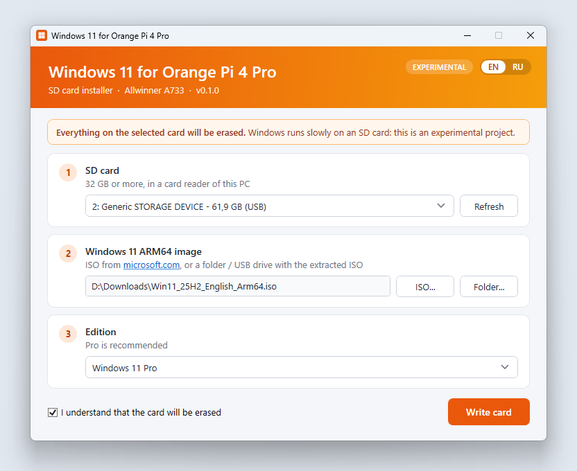
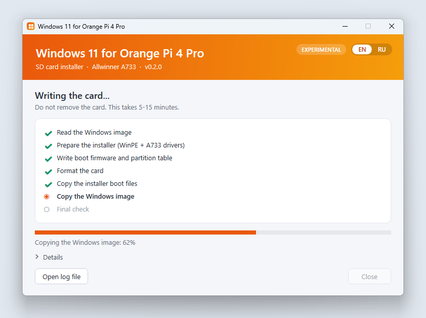

# Windows 11 on Orange Pi 4 Pro (Allwinner A733)

**[Русская версия](README.ru.md)**

> [!WARNING]
> **Experimental project.** Windows boots and is usable, but it is **slow and laggy**:
> there is no GPU driver (the screen is drawn by the CPU), the system runs from a microSD
> card, and many devices have no driver yet. Expect bugs. Use a spare SD card: the installer
> **erases the whole card**. Nothing here is affiliated with Orange Pi, Allwinner or Microsoft.

This repository lets you install **Windows 11 ARM64** on a microSD card and boot it on an
**Orange Pi 4 Pro** (Allwinner A733). It contains:

- a **UEFI firmware** (EDK2 port) that boots from the SD card after the vendor U-Boot;
- Windows **drivers** for the A733 SD card controller and the Gigabit Ethernet;
- an **installer for Windows PCs** that prepares the SD card from your own Windows 11 ARM64 ISO.

Windows itself is **not** included: you download the official ISO from Microsoft.

## What works

| Part | Status | Details |
|---|---|---|
| Boot from microSD (U-Boot → UEFI → Windows 11 ARM64) | ✅ works | |
| CPU, 8 cores | ⚠️ works | fixed clocks (A76 1896 MHz, A55 1800 MHz), no thermal throttling in Windows: use a fan or a heatsink |
| RAM | ✅ works | tested on the 4 GB board |
| microSD | ⚠️ works, slowly | ~20 MB/s read, ~10–13 MB/s write; the driver has no DMA yet, the system lags during disk activity |
| Ethernet (RJ45) | ✅ works | tested at 100 Mbit/s, gigabit not tested |
| HDMI | ⚠️ works | **1024×600 only** on any monitor (stretched), no resolution change; *Microsoft Basic Display Adapter* |
| USB: white port under the blue one | ✅ works | keyboard, mouse |
| USB: right-hand pair | ⚠️ unstable | devices come and go ("Device Descriptor Request Failed") |
| USB: blue port (USB 3.0) | ❌ not working | devices are not detected |
| Restart / shut down | ✅ works | the board powers off completely |
| GPU acceleration | ❌ no | the CPU draws the desktop, video playback is poor |
| Audio (HDMI and jack), Wi-Fi, Bluetooth | ❌ no | |
| PCIe / NVMe, NPU, sleep and hibernation | ❌ no | |

Windows runs in **test mode** (a watermark in the corner), because the A733 drivers are test-signed.

## What you need

- Orange Pi 4 Pro (A733). Tested with the 4 GB RAM version. A fan or heatsink is recommended.
- A **microSD card of 32 GB or more** (A1/A2, U1/U3; tested with a KIOXIA Exceria 64 GB). It will be erased.
- A Windows 10/11 x64 PC with a card reader.
- The **Windows 11 ARM64 ISO** from Microsoft: <https://www.microsoft.com/software-download/windows11arm64>
  (an extracted ISO folder or a USB installer drive also works).
- HDMI monitor, USB keyboard and mouse, optionally an Ethernet cable.

## Install

> [!IMPORTANT]
> The automatic installer is **new and has not yet been run end-to-end on a board**.
> It was tested on a virtual disk on a PC, and every step it automates was done by hand on the real
> board. If you try it, please open an issue with the result (a photo of the screen helps).





1. Download **`A733-Windows-Installer.exe`** from
   [Releases](https://github.com/Kiril-Donec/windows-opi4pro/releases).
   It is one file (~2.5 MB) with the firmware and drivers inside; it needs nothing else installed.
2. Insert the SD card into the PC.
3. Run the exe and allow administrator access. The exe is not code-signed, so Windows SmartScreen may
   say *"Windows protected your PC"*: press **More info → Run anyway**.
4. In the window choose the SD card, the ISO (or folder) and the edition (Pro is selected by default),
   tick the checkbox and press **Write card**. It takes 5–15 minutes, mostly copying the image.
5. Put the card into the Orange Pi, connect HDMI, keyboard and mouse (white USB port), power on.
6. A blue screen *"Orange Pi 4 Pro Windows installer, stage 2"* appears. It installs Windows **by itself
   (20–60 minutes)** and reboots. Do not power off the board during this time.
7. The normal Windows setup screens follow. If there is no network, choose
   *"I don't have internet"*.

**Command line:** the same exe works without the window (run it from an administrator terminal):
command line:

```powershell
.\A733-Windows-Installer.exe --run --disk 2 --source D:\Win11_Arm64.iso --index 6 --log C:\a733-install.log
```

### What the installer does

On the PC (`app/A733Installer`):

1. writes the 64 MiB firmware image (boot0, U-Boot, UEFI) to the start of the card;
2. writes a **special GPT**: its partition entries sit at LBA 1024 and the first usable sector is 65536,
   so no partition can ever overwrite the Allwinner boot area (boot0 at sectors 16–495, U-Boot at 32800+).
   A standard GPT would destroy boot0 — never let Windows Setup or Disk Management repartition this card;
3. formats a 1 GiB EFI partition and the Windows partition;
4. puts the Windows Setup WinPE (`boot.wim` from your ISO) on the EFI partition, adding the A733 drivers
   and a script (`installer/winpe/install.cmd`) that replaces Windows Setup;
5. copies `install.wim`/`install.esd` to the Windows partition.

On the board, the script loads the SD driver, applies Windows with `DISM /Compact`, adds the drivers,
turns off hibernation (otherwise *Shut down* hangs) and a few services that write to the card,
runs `bcdboot`, enables test signing and reboots.

## Tips

- Windows is slow on an SD card. After setup, disable what you do not need (OneDrive, widgets,
  startup apps). The faster the card's random write speed (A2), the better.
- Do not use *Fast Startup* / hibernation (the installer turns it off).
- Debug output: UART0 on the 3-pin debug header (115200 8N1). The Windows emergency console (SAC)
  is on the 40-pin header UART7 (pin 8 TX, pin 10 RX).
- If stage 2 fails, the screen turns red and shows the error; the log is in `X:\a733\install.log`
  and is copied to `a733-install.log` on the Windows partition.

## Repository

| Path | What |
|---|---|
| `app/A733Installer/` | the installer exe (C#, WPF, .NET Framework 4.8); firmware, drivers and the WinPE script are embedded at build time |
| `installer/winpe/` | the script that runs on the board (WinPE): applies Windows, adds the drivers, writes the boot files |
| `firmware/opi4pro-a733-uefi-v60.img.gz` | 64 MiB card image: MBR, boot0, U-Boot (Orange Pi), UEFI v60 |
| `drivers/sd`, `drivers/ethernet` | test-signed ARM64 driver packages (SD 2.6.0.0, Ethernet 0.2.2.0) |
| `src/uefi/` | EDK2 platform package `OrangePi4ProPkg` and the build script |
| `src/drivers/` | driver sources (WDK, ARM64) |

## Building

- **Installer exe**: `dotnet build -c Release` in `app/A733Installer` (.NET SDK 8 or newer on Windows).
- **UEFI**: see `src/uefi/build-v60.sh` (Linux/WSL, EDK2 + clang).
- **Drivers**: Visual Studio 2022+ with the WDK, `build-driver.ps1` in each driver folder, then
  `sign-package.ps1` with your own test certificate.

## Known problems

- Display stays at 1024×600 (the vendor U-Boot skips the monitor's EDID); Full HD is being worked on.
- No GPU acceleration: the CPU draws the desktop, video playback is poor.
- The SD driver still uses programmed I/O (no DMA): disk access costs CPU time. DMA and UHS-I
  (1.8 V, up to ~90 MB/s) are planned.
- USB: only the white port under the blue one is reliable.
- No CPU thermal throttling in Windows: use a fan.

## License

The installer and the drivers: MIT (see `LICENSE`). The UEFI platform package: BSD-2-Clause-Patent
(`src/uefi/OrangePi4ProPkg/LICENSE`). Third-party binaries in the firmware image: see `NOTICE.md`.
