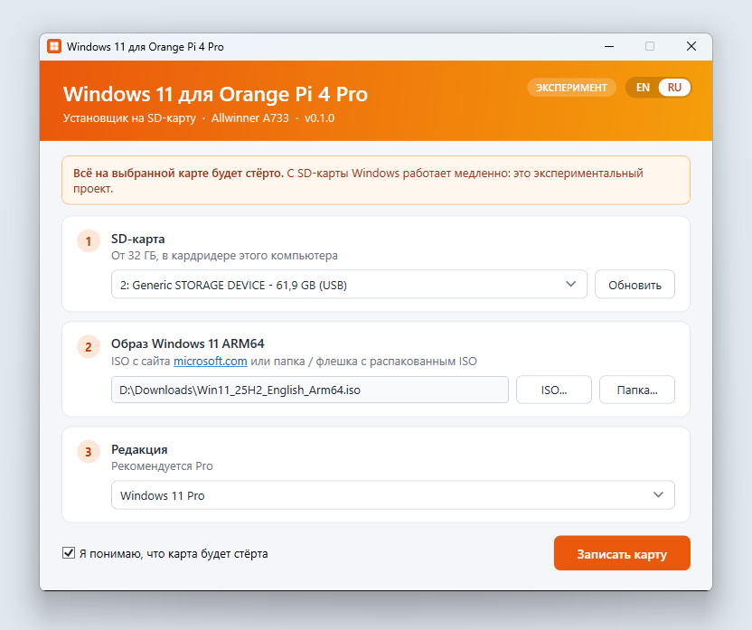
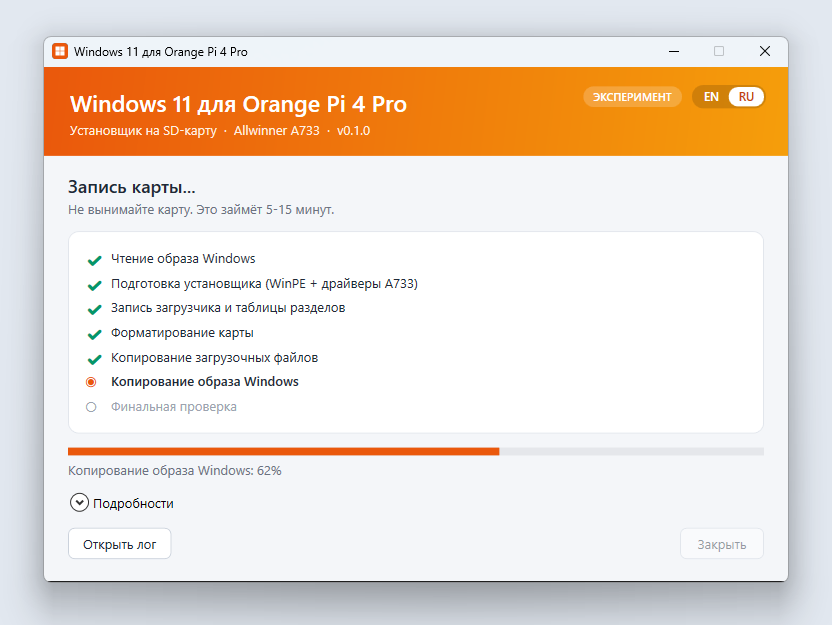

# Windows 11 на Orange Pi 4 Pro (Allwinner A733)

**[English version](README.md)**

> [!WARNING]
> **Экспериментальный проект.** Windows загружается и работает, но **медленно и подлагивает**:
> драйвера видеокарты нет (экран рисует процессор), система работает с microSD-карты, и для многих
> устройств драйверов пока нет. Будут баги. Берите отдельную карту: установщик **стирает её целиком**.
> Проект не связан с Orange Pi, Allwinner или Microsoft.

Этот репозиторий позволяет поставить **Windows 11 ARM64** на microSD-карту и запустить её на
**Orange Pi 4 Pro** (Allwinner A733). В нём:

- **прошивка UEFI** (порт EDK2), которая загружается с карты после U-Boot от производителя;
- **драйверы** Windows для SD-контроллера A733 и гигабитного Ethernet;
- **установщик для ПК с Windows**, который готовит карту из вашего ISO Windows 11 ARM64.

Самой Windows здесь **нет**: официальный ISO скачивается у Microsoft.

## Что работает

| Что | Состояние |
|---|---|
| Загрузка: U-Boot → UEFI → Windows 11 ARM64 с microSD | работает |
| Процессор: 8 ядер, A76 1896 МГц, A55 1800 МГц | работает (частоты фиксированы, троттлинга в Windows нет) |
| Память | работает (проверено на версии с 4 ГБ) |
| microSD | работает: High Speed 50 МГц, ~20 МБ/с чтение, ~10–13 МБ/с запись |
| Ethernet (RJ45) | работает (проверено на линке 100 Мбит/с) |
| HDMI | картинка через буфер кадра UEFI («Базовый видеоадаптер Майкрософт»), **пока 1024×600**, Full HD в работе |
| USB-клавиатура / мышь | работают в **белом USB-порту** под синим |
| Перезагрузка / выключение | работают |
| Ускорение GPU, звук, Wi-Fi / Bluetooth, USB 3.0, правые USB-порты, NPU, PCIe/NVMe, сон | **не работают** |

Windows работает в **тестовом режиме** (надпись в углу экрана): драйверы A733 подписаны тестовой подписью.

## Что нужно

- Orange Pi 4 Pro (A733). Проверено на версии с 4 ГБ ОЗУ. Желателен вентилятор или радиатор.
- **microSD от 32 ГБ** (A1/A2, U1/U3; проверено на KIOXIA Exceria 64 ГБ). Она будет стёрта.
- ПК с Windows 10/11 x64 и кардридером.
- **ISO Windows 11 ARM64** от Microsoft: <https://www.microsoft.com/software-download/windows11arm64>
  (подойдёт и распакованная папка ISO или установочная флешка).
- HDMI-монитор, USB-клавиатура и мышь, по желанию кабель Ethernet.

## Установка

> [!IMPORTANT]
> Автоматический установщик (версия 0.1.0) **новый и ещё не прогонялся целиком на плате**.
> Он проверен на виртуальном диске на ПК, а все шаги, которые он делает сам, были выполнены вручную
> на настоящей плате. Если попробуете, напишите о результате в Issues (фото экрана очень помогает).





1. Скачайте репозиторий (**Code → Download ZIP** или релиз) и распакуйте.
2. Вставьте SD-карту в ПК.
3. Запустите **`Install-Windows-on-SD.cmd`** и разрешите права администратора.
4. В окне выберите карту, ISO (или папку) и редакцию (по умолчанию Pro), поставьте галочку и нажмите
   **«Записать карту»**. Это 5–15 минут, в основном копирование образа.
5. Вставьте карту в Orange Pi, подключите HDMI, клавиатуру и мышь (белый USB-порт) и включите плату.
6. Появится синий экран *«Orange Pi 4 Pro Windows installer, stage 2»*. Он **сам** ставит Windows
   (**20–60 минут**) и перезагружается. Плату в это время не выключайте.
7. Дальше обычная настройка Windows. Если сети нет, выберите *«У меня нет интернета»*.

Без окна, из командной строки:

```powershell
.\installer\Install-A733Windows.ps1 -NoGui -DiskNumber 2 -IsoPath D:\Win11_Arm64.iso -ImageIndex 6
```

### Что делает установщик

На ПК (`installer/Install-A733Windows.ps1`):

1. пишет в начало карты образ прошивки на 64 МиБ (boot0, U-Boot, UEFI);
2. пишет **особую GPT**: таблица разделов лежит в секторе 1024, а первый доступный сектор 65536, так что
   никакой раздел не может затереть загрузочную область Allwinner (boot0 в секторах 16–495, U-Boot с 32800).
   Обычная GPT уничтожила бы boot0, поэтому **никогда не давайте установщику Windows или «Управлению
   дисками» переразмечать эту карту**;
3. форматирует EFI-раздел на 1 ГиБ и раздел Windows;
4. кладёт на EFI-раздел WinPE установки Windows (`boot.wim` из вашего ISO), добавив в него драйверы A733
   и скрипт `installer/winpe/install.cmd` вместо обычной программы установки;
5. копирует `install.wim`/`install.esd` на раздел Windows.

На плате скрипт загружает SD-драйвер, применяет Windows через `DISM /Compact`, добавляет драйверы,
отключает гибернацию (иначе «Завершение работы» зависает) и пару служб, которые пишут на карту,
выполняет `bcdboot`, включает тестовый режим и перезагружает плату.

## Советы

- С SD-карты Windows работает медленно. После установки отключите лишнее (OneDrive, виджеты,
  автозагрузку). Чем выше у карты скорость случайной записи (A2), тем лучше.
- Не включайте «Быстрый запуск» и гибернацию (установщик их выключает).
- Отладочный вывод: UART0 на 3-контактном разъёме (115200 8N1). Аварийная консоль Windows (SAC) на
  40-контактном разъёме, UART7 (контакт 8 TX, 10 RX).
- Если этап 2 не удался, экран станет красным и покажет ошибку; лог лежит в `X:\a733\install.log`
  и копируется в `a733-install.log` на разделе Windows.

## Состав репозитория

| Путь | Что |
|---|---|
| `Install-Windows-on-SD.cmd` | запуск установщика |
| `installer/` | установщик для ПК (PowerShell + WinForms), работа с диском и GPT, скрипт WinPE |
| `firmware/opi4pro-a733-uefi-v60.img.gz` | образ на 64 МиБ: MBR, boot0, U-Boot (Orange Pi), UEFI v60 |
| `drivers/sd`, `drivers/ethernet` | тестово подписанные драйверы ARM64 (SD 2.6.0.0, Ethernet 0.2.2.0) |
| `src/uefi/` | пакет платформы EDK2 `OrangePi4ProPkg` и скрипт сборки |
| `src/drivers/` | исходники драйверов (WDK, ARM64) |

## Сборка

- **UEFI**: `src/uefi/build-v60.sh` (Linux/WSL, EDK2 + clang).
- **Драйверы**: Visual Studio 2022+ с WDK, `build-driver.ps1` в папке драйвера, затем
  `sign-package.ps1` со своим тестовым сертификатом.

## Известные проблемы

- Экран остаётся 1024×600 (U-Boot производителя пропускает EDID монитора); над Full HD работаем.
- Нет ускорения GPU: рабочий стол рисует процессор, видео воспроизводится плохо.
- SD-драйвер пока работает без DMA: обмен с картой нагружает процессор. DMA и UHS-I
  (1,8 В, до ~90 МБ/с) в планах.
- USB: надёжно работает только белый порт под синим.
- В Windows нет термозащиты процессора: используйте вентилятор.

## Лицензия

Установщик и драйверы: MIT (`LICENSE`). Пакет платформы UEFI: BSD-2-Clause-Patent
(`src/uefi/OrangePi4ProPkg/LICENSE`). Сторонние бинарники в образе прошивки: см. `NOTICE.md`.
